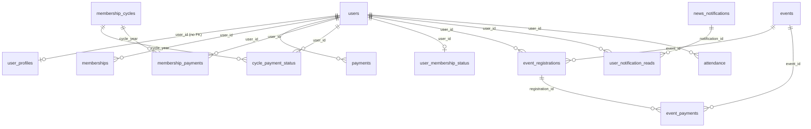

# Database Audit

## Method
`lib/next_auth(4).sql` (phpMyAdmin dump, identical to `_archive/aiven_ready.sql`) was imported into a **disposable** MySQL 8.0 container (`log_bin_trust_function_creators=1` was needed because the dumped function `calculate_membership_fee` lacks `DETERMINISTIC/READS SQL DATA`). All queries below were run against that copy. The production schema may have been altered by later scripts (`database/fix_all_table_pks.sql`, `migrations/*`) — **production state is Unknown**.

## Inventory (36 tables, 1 function, 1 trigger)
| Group | Tables (rows in dump) |
|---|---|
| Identity | `users` (8), `users_backup` (20), `user_profiles` (22), `deleted_users` (2), `login_logs` (0), `audit_logs` (0) |
| Membership | `memberships` (17), `membership_payments` (37), `membership_cycles` (4), `cycle_payment_status` (0), `user_membership_status` (0), `membership_fees` (0), `membership_sequence` (2), `payment_reminders` (0), `penalty_notifications` (3) |
| Payments | `payments` (43), `payment_notifications` (1), `event_payments` (4), `event_payments_azampay` (5), `event_payment_callbacks` (4) |
| Events | `events` (2), `event_registrations` (25), `attendance` (0) |
| Content/CMS | `about_content`, `contact_content`, `home_content`, `footer_content`, `navbar_content`, `menu_items`, `pages`, `site_settings`, `media` |
| Messaging | `news_notifications` (5), `user_notification_reads` (11), `contact_submissions` (5) |
| Other | `inventory` (0) |
Routine: `calculate_membership_fee` (function). Trigger: `generate_membership_number` BEFORE INSERT on `users`.
Note: a `messages` table used by `app/api/messages` is **not in the dump** (created by `database/create_messages_table.sql`).

## Key tables (as dumped)
- `users`: PK `id` AUTO_INCREMENT, UNIQUE `email`, idx `membership_number`, `is_approved`. Columns include `is_admin`, `role` (all rows `member`, admin is via `is_admin`), `membership_type enum(librarian,regular,organization)`, `refresh_token`, `reset_token` (plaintext 6-digit), `payment_status`, `total_penalties`, `is_new_member`. **No `user_category` column**, although `enhancedMembershipCycles.getUserCategory()` queries it (falls back silently).
- `payments`: `id INT NOT NULL` — **no PK, no AUTO_INCREMENT**, no index on `user_id` or `reference`, no UNIQUE on `reference`; `status enum('pending','completed','failed')`; `membership_type enum('personal','organization')` (different vocabulary from `users.membership_type`).
- `membership_payments`, `memberships`, `cycle_payment_status`, `user_membership_status`, `membership_cycles`, `events`, `event_registrations`, … : same pattern — **29 of 36 tables have no PRIMARY KEY**; only 7 tables got `ALTER TABLE … ADD PRIMARY KEY` in the dump.
- `membership_cycles`: base_fee **50000** for 2025–2028, `grace_period_end` = April 1, penalty 1000/month — contradicts the 40k/30k fees used by most code.

## Integrity findings (verified on dump)
| # | Finding | Evidence | Impact |
|---|---|---|---|
| D1 | **Zero foreign keys** in the whole schema | `information_schema.key_column_usage` returns none | Orphans, no cascades |
| D2 | 29/36 tables lack PK/AUTO_INCREMENT | `SHOW CREATE TABLE payments` | Runtime: `POST /api/membership/pay` and `POST /api/admin/payment` fail with `Field 'id' doesn't have a default value` (verified). Rows with `id=0` exist (visible in report export) |
| D3 | Orphans | payments 34/43, membership_payments 32/37, memberships 13/17, user_profiles 19/22 reference non-existent users; 5 users have no profile | Reports/aggregates count ghost members |
| D4 | Invalid enum values stored | 8 `payments` rows with `status=''` — consistent with refund route writing `'refunded'` (not in enum) under non-strict mode | Silent data corruption; refund route fails under strict mode |
| D5 | Duplicate payment reference | `TEST-1768493858009` ×2; no UNIQUE | Double-credit risk |
| D6 | Membership number divergence | e.g. user 39: memberships `TLA2600014`, profile `TLA202642805`, users `TLA2619976` | Card/ID mismatch |
| D7 | No real payments | methods: `Test Payment` 26, `test` 8, `halopesa` 9 (all pending) | No evidence gateway completion ever worked |
| D8 | Multiple overlapping ledgers | see SYSTEM_ARCHITECTURE "Payment ledgers"; `cycle_payment_status`/`user_membership_status` empty while code writes them "best-effort" | Status can disagree between tables |
| D9 | `users_backup` (20 rows) & full dump with emails/NIDA/hashes committed in git | `lib/next_auth(4).sql`, `_archive/aiven_ready.sql` | Personal data exposure |
| D10 | Mixed collations (`utf8mb4_unicode_ci` vs `utf8mb4_0900_ai_ci`) | SHOW CREATE TABLE | Join collation errors possible |
| D11 | No migration runner/tracking; 59 ad-hoc scripts in `database/` | directory listing | Schema drift; non-reproducible environments |
| D12 | Transactions used only in some flows (`register`, some payment-success paths); payment completion writes 3–5 tables without a transaction in several routes (`app/api/membership/pay`, `lib/membership.ts#updateMembershipPayment`) | source | Partial updates on failure |
| D13 | `membership_sequence` consumed by unauthenticated `GET /api/membership/next-number` | runtime | Number gaps |

## ER diagram (logical — relationships are implied by column names, none enforced)

## Recommendations
1. Obtain a schema-only dump of production and diff it against the repo (`SHOW CREATE TABLE` for all tables) before any change.
2. Add PK/AUTO_INCREMENT (scripted in `database/fix_all_table_pks.sql` — review first), then FKs after orphan clean-up decisions.
3. UNIQUE (`payments.reference`), UNIQUE (`membership_payments.user_id, cycle_year`), indexes on `user_id` columns.
4. Choose a single ledger of record for membership payments; derive status views from it.
5. Introduce a migration tool with a tracking table; retire ad-hoc scripts.
6. Remove dumps/backup tables with personal data from git history.
