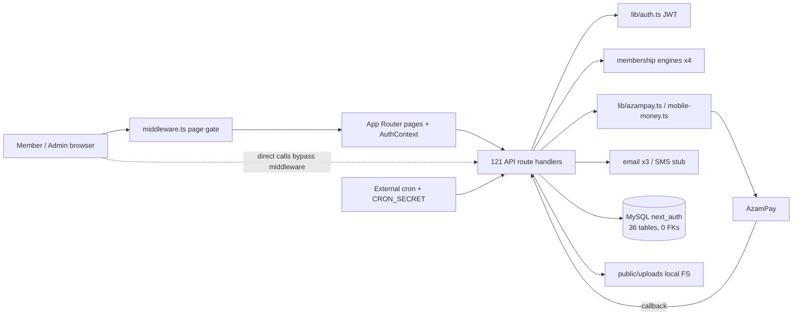

# System Architecture

## Technology classification
| Technology | Evidence | Classification |
|---|---|---|
| Next.js 16.1.1 App Router (Turbopack) | `package.json`, `app/` | Actively implemented |
| React 19.2.3, Tailwind 4, Radix/shadcn `components/ui` | `components/` | Actively implemented |
| TypeScript 5, `strict:false`, `ignoreBuildErrors:true` (`next.config.js`) | `tsconfig.json` | Active, type safety disabled |
| MySQL + `mysql2/promise` raw SQL | `lib/db.ts` (`pool`, `query`, `executeInTransaction`) | Actively implemented (only real datastore) |
| Custom JWT (`jsonwebtoken`, HS256, 7-day, cookie `token`) | `lib/auth.ts` `generateToken/verifyToken`, `app/api/auth/login` | Actively implemented |
| `jose` refresh tokens | `app/api/auth/refresh/route.ts` | Dead code — `refreshToken` cookie is never set; issued token has `userId` claim but consumers read `decoded.id` |
| NextAuth | `app/api/auth/[...nextauth]/route.ts` (TS errors) | Installed, effectively unused |
| better-auth, Convex (`convex/_generated` only), `mssql` | `package.json` | Installed but apparently unused |
| PHP API (`api/auth/*.php`, `Database.php`, `jwt.php`) | requires `vendor/autoload.php`, no composer.json | Legacy, not runnable |
| Email: `nodemailer` (3 wrappers: `lib/email.ts`, `lib/email-simple.ts`, `lib/email-config.ts`), `resend` dep | | Active (needs SMTP env); duplicated |
| SMS: `lib/notificationService.ts#sendSmsNotification` | Twilio code commented out | Stub / not implemented |
| AzamPay | `lib/azampay.ts`, `app/api/payments/azampay/{checkout,callback}` | Implemented, not verifiable without sandbox creds |
| Pesapal, M-Pesa/Tigo/Airtel/HaloPesa env vars | `app/api/payment/pesapal`, `lib/mobile-money.ts` | Partial / unknown |
| Charts: recharts/chart.js; PDF: jspdf, html2canvas; xlsx export | admin reports, cards | Active |
| File storage | local filesystem `public/uploads/{documents,profile-pictures}` | Active; not durable on serverless; committed to git |
| Deployment | `@vercel/*` packages, `NEXTAUTH_URL`, Aiven MySQL guide (`AIVEN_MIGRATION_GUIDE.md`) | Unknown (no vercel.json/Dockerfile) |
| Tests | none | Not found |

## Conflicting systems
- **Auth:** custom JWT (active) vs NextAuth route vs better-auth dep vs jose refresh route vs PHP JWT.
- **Membership/fee engines:** `lib/membershipCycles.ts` (50k), `lib/enhancedMembershipCycles.ts` (40k/30k/150k), `lib/membership-pricing.ts` (client copy), `lib/membershipPayment.ts` (50k + 10k/yr flat), plus route-local math in `app/api/membership/pay` (10% penalty) and `pay-early`.
- **Payment ledgers:** `payments` (gateway/user payments), `membership_payments` (per-cycle), `cycle_payment_status` + `user_membership_status` (0 rows in dump), `memberships.amount_paid`, `users.last_payment_year/payment_status/total_penalties`, `event_payments`, `event_payments_azampay`.
- **Membership number:** stored in `users`, `user_profiles` and `memberships` with 3+ generators (`lib/membership.ts` sequence, `enhancedMembershipCycles.generateMembershipNumber` random 5 digits, `/api/membership/next-number` `MEM` prefix, DB trigger `generate_membership_number`). Values diverge per user in the dump.
- **Config:** `next.config.js` and `next.config.ts` both exist.

## Request lifecycle (actual)
```
Browser ──► middleware.ts
   │  path starts with /api ? ──► pass through (NO auth here)
   │  public auth pages ? ─────► pass
   │  else read `token` cookie / Bearer → fetch(`/api/auth/me`) → 307 /auth/login if invalid
   │  /admin/* and !isAdmin ──► 307 /dashboard
   ▼
app/**/page.tsx (mostly client components) ──fetch──► app/api/**/route.ts
                                                       │ each route decides itself whether to call verifyToken()
                                                       │ (48/121 route files contain no token check)
                                                       ▼
                                             lib/* helpers ──► mysql2 pool ──► MySQL
                                                       │
                                                       ├─► AzamPay / SMTP (outbound)
                                                       └─◄ AzamPay callback (inbound, signature checked only if NODE_ENV=production)
```

## Architecture diagram

