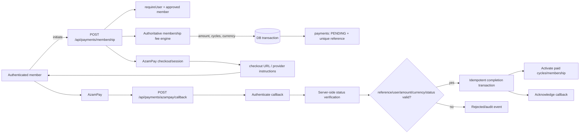

# Phase 1 Payment Architecture Investigation

Date: 2026-11-02  
Status: investigation/proposal only. Phase 0 `503` containment remains active.

## Current implementation inventory

| Path/library | Current role | Finding |
|---|---|---|
| `/api/membership/pay` | Direct membership activation | Authenticated member can supply transaction details and mark records paid. Disabled by Phase 0. |
| `/api/membership/pay-early` | Pending early-cycle record | Accepts client amount/reference; writes pending membership/payment. Disabled. |
| `/api/membership/complete-payment` | Direct completion | Accepts reference/amount and activates membership. Disabled. |
| `/api/membership/payment-success` | Client-declared success processor | Updates payment and membership records. Disabled. |
| `/api/payments/process` | POST payment processor | Calculates unpaid cycles but trusts client payment reference/method and activates paid state. GET remains member-only; POST disabled. |
| `/api/payments/complete` | Manual completion | Completes a pending payment without gateway/admin verification. Disabled. |
| `/api/payments/mobile-money` | Direct mobile-money initiation/status | Writes payment, calls simulated provider service; GET can update membership based on simulated success. Disabled. |
| `/api/payments/azampay/checkout` | AzamPay checkout initiation | Accepts client `userId`, `amount`, and membership fields; creates pending record and test checkout. Disabled. |
| `/api/payments/azampay/callback` | AzamPay webhook | Phase 0 returns `503` before side effects; previous logic had non-production signature bypass. |
| `/api/payment/pesapal` | Alternate provider | Separate implementation. Disabled. |
| `/api/payments/check-payment` | Member payment lookup | Own-record read only; retained. |
| `/api/payments/payment-status` | Member status | Own status read; retained. |
| `/api/payments` | Admin payment list | Admin-only by Phase 0. |
| `/api/admin/payments/*` | Admin payment operations | Admin-only by Phase 0; refund currently only changes local status. |
| `lib/azampay.ts` | Gateway client | Env credentials now required; test status cannot fabricate success; callback signature method fails closed. |
| `lib/mobile-money.ts` | Provider client | Simulation only; logs phone/reference and always simulates completion on status check. Unsafe for production. |
| `lib/membership.ts` | `updateMembershipPayment()` | Central activation helper; not fully transactional/idempotent and trusts caller-provided amount/status. |

## Conflicting implementations

1. Multiple endpoints activate membership independently.
2. `payments`, `membership_payments`, `memberships`, `cycle_payment_status`, and `user_membership_status` are updated by different paths with inconsistent fields/status values.
3. Amounts may come from the client, payment record, or fee calculator depending on path.
4. References are generated in several ways and current local schema does not enforce uniqueness.
5. Membership activation is not consistently wrapped in one DB transaction with `FOR UPDATE` locking.
6. GET endpoints can have side effects (`mobile-money` status check).
7. Simulated provider success can masquerade as a verified gateway result if routes are re-enabled unchanged.

## Proposed architecture



## Proposed request flow

```mermaid
sequenceDiagram
  participant M as Member browser
  participant A as App API
  participant D as Database
  participant Z as AzamPay

  M->>A: POST initiate membership payment
  A->>A: requireUser(); server calculates amount
  A->>D: begin; lock member/cycle rows
  A->>D: reject existing paid/active or return existing pending attempt
  A->>D: insert PENDING payment with unique app reference
  A->>Z: create checkout using server amount/reference
  Z-->>A: gateway reference/checkout URL
  A->>D: update PENDING -> PROCESSING with gateway ref/idempotency data
  A-->>M: checkout URL / instructions only
  Z-->>A: callback notification
  A->>A: verify callback authenticity
  A->>Z: query transaction status by gateway/app reference
  Z-->>A: authoritative transaction result
  A->>D: begin; lock payment/user/cycle rows
  A->>D: validate reference, user, amount, currency, status, transaction id
  A->>D: if new: mark SUCCESS and activate cycles atomically
  A->>D: if duplicate: return prior result without duplicate writes
  A-->>Z: acknowledgement
```

## Authoritative data policy

- Client may select only intended product/cycle count/payment provider.
- Server derives `user_id`, membership category, eligible cycles, base amount, penalties, total amount, currency, and app reference.
- Client-provided `amount`, `userId`, `transactionId`, `status`, `paymentReference`, and `success` must never be authoritative.
- A payment record’s stored amount remains the expected amount and must equal the verified gateway amount.

## Idempotency design

- App generates unique `payment.reference` per initiation or returns an existing open payment attempt.
- Gateway `transaction_id` is stored and uniqueness enforced where non-null.
- Completion handler claims the payment using an atomic transition such as `PENDING/PROCESSING -> SETTLING` with `FOR UPDATE`.
- If already `SUCCESS`, return stored result without reactivation.
- Duplicate callback for same `transaction_id` or reference produces no additional cycle/membership writes.
- Gateway timeout leaves payment in `PROCESSING` or `VERIFICATION_REQUIRED`, never `SUCCESS`.

## Failure/refund handling

- `FAILED`, `CANCELLED`, and `EXPIRED` do not activate membership.
- `REFUNDED` should require an admin/gateway-verified operation and must define whether membership is revoked per business rules; this is unresolved.
- Admin refund endpoint currently updates status only and does not verify gateway refund.

## Decision classification

| Decision | Classification |
|---|---|
| Multiple unsafe payment paths exist | VERIFIED |
| Current mobile-money service is simulated | VERIFIED |
| Current payment DB constraints are inadequate | VERIFIED |
| Single server-side payment processor required | ASSUMPTION / recommended |
| AzamPay checkout endpoint semantics | BLOCKED pending official docs |
| Callback signature mechanism | BLOCKED pending official docs |
| Refund business effect | REQUIRES APPROVAL |
