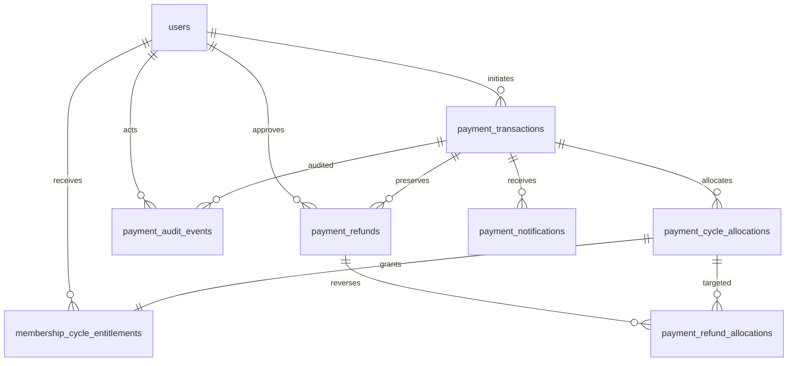

# Phase 1A Payment Database Schema

Date: 2026-11-02  
Scope: additive canonical foundation tested only in disposable `phase1a_test`; `next_auth` was not modified.

## Migration files

- `migrations/phase1a/001_member_schema_alignment.sql`
  - Adds `users.user_category` and its index.
  - Adds `messages` with sender/receiver foreign keys and indexes.
  - Omits unrelated fee, penalty and membership-number mutations from the older migration.
- `migrations/phase1a/002_payment_foundation.sql`
  - Adds canonical payment, allocation, notification, refund, entitlement and audit tables.

## Relationships

## Integrity controls

- `payment_transactions.reference`: unique internal payment reference.
- `(user_id, idempotency_key)`: prevents repeated initiation for one member.
- `(provider_code, provider_reference)`: prevents provider-reference collisions.
- `(provider_code, provider_transaction_id)`: prevents reuse of a verified provider transaction.
- `(payment_id, cycle_year)`: prevents duplicate cycle allocations.
- `(user_id, cycle_year)`: one canonical entitlement row per member cycle.
- `(payment_id, provider_event_id)`: deduplicates provider notifications.
- `payment_refunds.refund_reference`: unique internal refund record.
- `provider_refund_reference`: unique provider/manual refund confirmation reference.
- `payment_audit_events.actor_id`: records the authorized actor when applicable.
- Original payment is never overwritten/deleted by a refund.
- Refund allocations link each refund to the funded cycle allocation.

## Legacy-schema differences and reconciliation plan

Current local `next_auth` was inspected but not changed. It still differs materially:

- Missing `users.user_category`.
- Missing `messages`.
- Missing canonical Phase 1A payment tables.
- Key legacy tables report no indexes/foreign keys in the inspected schema.
- Existing `payments`, `membership_payments`, `memberships` and `cycle_payment_status` status vocabularies are inconsistent.
- Payment reference, provider transaction and refund-reference uniqueness are not established in legacy tables.

Reconciliation must begin with duplicate/orphan audits before adding constraints. No automatic repair or financial-record deletion is authorized.

## Limitations

- Canonical entitlements are the Phase 1A financial authority; legacy `memberships`/`cycle_payment_status` are refreshed as compatibility projections.
- Partial allocation refunds are unsupported.
- Combined payments are currently bounded by the authoritative eligible-cycle engine to current plus two future cycles.
