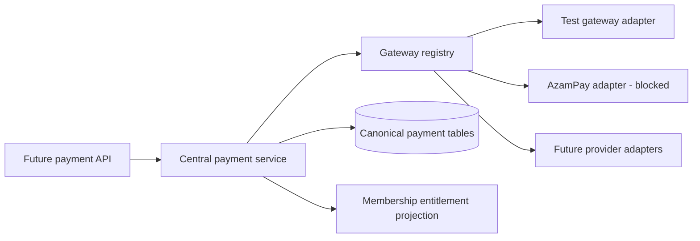

# Phase 1A Payment Gateway Architecture

Date: 2026-11-02

## Design

Gateway-specific work is isolated behind `PaymentGateway` in `lib/payments/types.ts`. `lib/payments/service.ts` owns member/cycle validation, authoritative amount calculation, internal references, allocations, state transitions, settlement, membership projection, refunds, and audit history.

## Adapter contract

- `initiatePayment`
- `verifyNotification`
- `checkTransactionStatus`
- `initiateRefund` / `verifyRefund` where supported
- Provider-specific authentication, payload parsing, and errors remain inside the adapter
- Normalized `GatewayVerification` results return to the service

## Provider status

| Provider | Status |
|---|---|
| `test-gateway` | Test-only adapter; never a production provider |
| `azampay` | Adapter integration points exist; all methods fail closed and are `BLOCKED` pending official docs/credentials |
| Other gateways | No invented integrations; add adapters only after specs/credentials |

## Security boundary

Adapters cannot activate membership or mark payments successful. Only the central service can settle after provider status, amount, currency, member reference, state, and duplicate checks pass.
