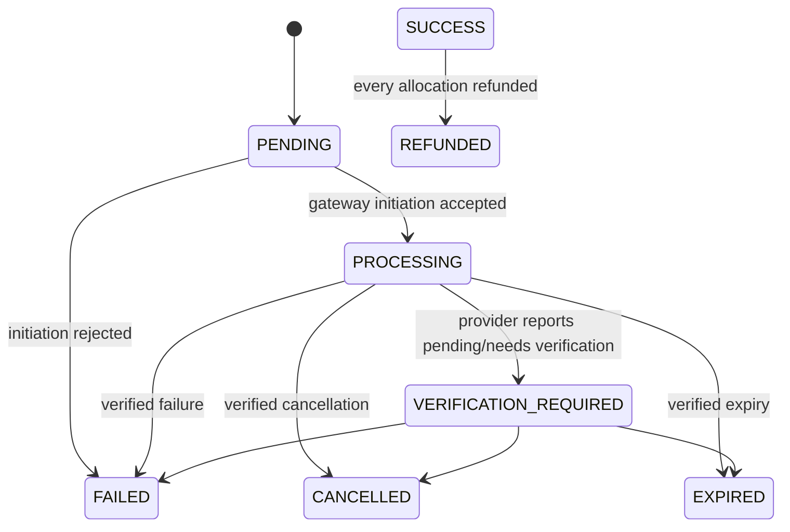

# Implemented Payment State Machine — Phase 1A

Canonical states are persisted in `payment_transactions.status`.

`SUCCESS` is intentionally absent from generic transition edges because only `settlePayment()` may establish it after authoritative gateway verification.

## Guards

- `SUCCESS` requires `settlePayment()` and adapter verification.
- Verification must match provider reference, member reference where supplied, amount, currency and provider state.
- `PENDING -> SUCCESS`, `PROCESSING -> SUCCESS`, and `VERIFICATION_REQUIRED -> SUCCESS` through `transitionPayment()` are invalid.
- Administrators cannot bypass this restriction because the helper has no privileged `SUCCESS` path.
- Failed/cancelled/expired states are terminal.
- `REFUNDED` occurs only when every allocation is refunded; partial refunds preserve payment `SUCCESS` while reversing selected allocations.
- Settlement locks payment and allocations with `FOR UPDATE`.
- Duplicate notifications are deduplicated by `(payment_id, provider_event_id)` and by already-successful payment state.
- Notification rows are recorded only after settlement succeeds, so retryable callbacks are not consumed by failed settlement.
- Rejected verification writes audit evidence and leaves the payment unsettled.
- Provider transaction IDs are unique across canonical payments.
