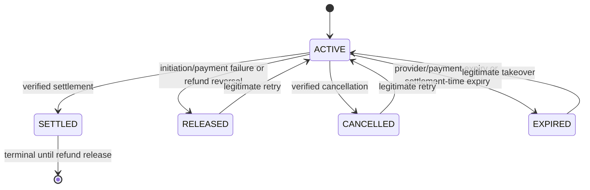

# Phase 1B Payment Reservation Design

Date: 2026-11-02  
Scope: disposable `phase1a_test` schema only. `next_auth` was not modified.

## Purpose

`payment_cycle_reservations` provides one durable member-cycle claim so two payment intents cannot compete for the same membership cycle.

## Lifecycle

## Controls

- Unique `(user_id, cycle_year)` permits only one reservation row.
- `payment_id` binds an active reservation to one payment.
- `expires_at` permits legitimate takeover after expiry.
- Payment initiation locks the member and reservation row inside the local transaction.
- Settlement locks the locked payment, its allocations, and each reservation.
- Settlement rejects missing/replaced/inactive reservations and records `SETTLEMENT_RECONCILIATION_REQUIRED`.
- Expired reservation at settlement is marked `EXPIRED`, payment is marked `EXPIRED`, and reconciliation is audited because provider money may already have been collected.
- Successful settlement marks the reservation `SETTLED`.
- Failed/cancelled/expired transitions release the reservation safely.
- Refund completion releases the refunded cycle reservation without affecting other funded cycles.

## External-payment reconciliation

If a provider succeeds externally but the local reservation has expired or another verified payment funded the cycle, settlement does not grant an entitlement and records a reconciliation event. The implementation does not automatically refund externally collected money because provider refund semantics and evidence are not yet known for AzamPay.

## Coverage

Verified:

- two competing intents in separate processes — one wins, one fails;
- same-cycle second intent is rejected while the reservation is active;
- expired reservation takeover is allowed;
- replaced reservation prevents settlement;
- failed initiation releases the reservation;
- two independent settlement workers produce exactly one financial effect;
- duplicate provider event IDs are deduplicated;
- refunded cycle releases its reservation.
