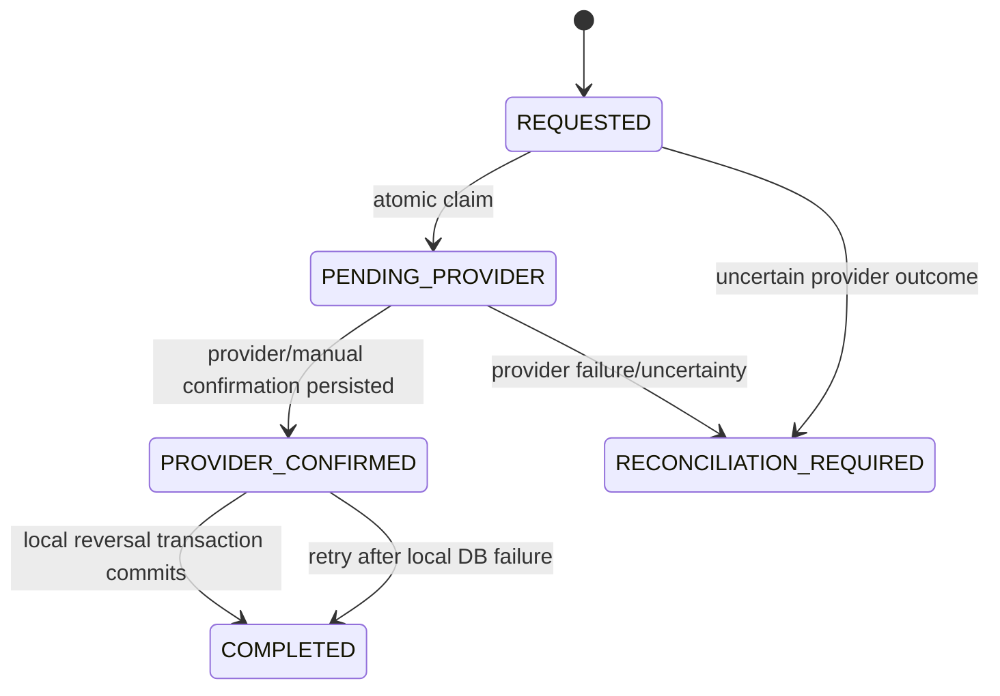

# Phase 1B Refund Workflow

Date: 2026-11-02  
Scope: disposable `phase1a_test` only.

## Design

Refunds now use a durable `payment_refund_requests` outbox before any provider operation.

## Guarantees

- Generic `transitionPayment()` cannot create `REFUNDED`.
- Refund actor must exist and be an administrator.
- Manual refunds require `manualApprovalId` and supporting `evidence`; only the hash is persisted.
- The original `SUCCESS` payment remains preserved until every allocation is refunded.
- Selected allocations move atomically from `PAID` to `REFUNDING` when the durable request is created.
- `payment_id + request_key` makes refund requests idempotent.
- Only one process can atomically claim `REQUESTED` or `RECONCILIATION_REQUIRED` into `PENDING_PROVIDER`.
- Provider calls execute outside database transactions and row locks.
- Provider refund references are persisted before confirmation is marked, allowing retry by provider-reference verification instead of blind re-initiation.
- A request without a provider refund reference and with uncertain outcome remains `RECONCILIATION_REQUIRED`; it cannot blindly repeat provider initiation.
- Provider confirmation is persisted independently from local completion.
- If provider confirmation is persisted and local completion fails, retry completes locally without calling the provider again.
- Refund completion locks request, payment, and `REFUNDING` allocations, creates `payment_refunds`/`payment_refund_allocations`, reverses only matching entitlements, updates only the funding `payment_reference`, refreshes membership projection, and audits actor/request/refund IDs.
- Refunding a cycle releases its reservation and preserves unrelated paid cycles.

## Test evidence

Disposable tests verified:

- unauthorized actor rejected;
- missing manual approval/evidence rejected;
- provider unconfirmed refund rolls back without `payment_refunds`;
- provider-confirmed/local-failure simulation completes on retry;
- `refundInitiations === 1` after recovery, proving no duplicate external refund;
- duplicate refund worker attempts create one refund;
- one refunded allocation reverses only its own entitlement;
- unrelated active allocations remain active;
- manual refund persists approval/evidence hash/actor/timestamps;
- `SUCCESS -> REFUNDED` generic transition is rejected.

## Remaining limitation

Provider refund recovery for a network failure after initiation but before the provider reference is returned is necessarily `RECONCILIATION_REQUIRED`. Without official provider reconciliation semantics, no automatic retry is allowed.
