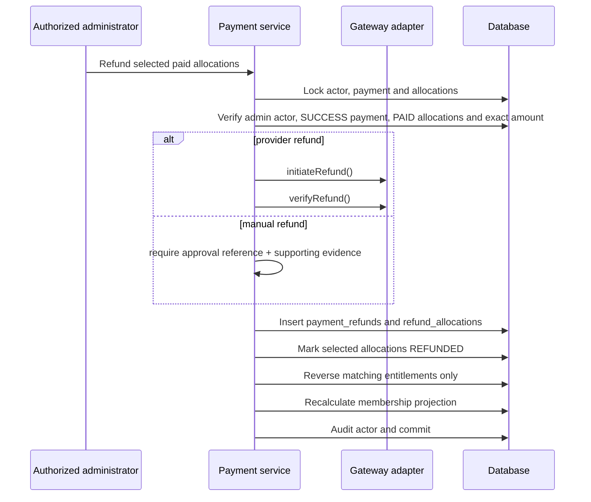

# Refund and Membership Reversal — Phase 1A

## Approved policy

A confirmed refund reverses only the membership-cycle entitlement funded by the refunded allocation. Other allocations and independently paid cycles remain active.

## Flow

## Safeguards

- Refund actor must exist and be an administrator.
- Original `SUCCESS` payment remains preserved.
- Refund is stored separately in `payment_refunds`; target cycles are stored in `payment_refund_allocations`.
- Only `PAID` allocations are refundable.
- Refund amount must exactly equal the selected allocation amount; partial-allocation refunds are out of scope.
- Duplicate refund is rejected because refunded allocations are no longer `PAID`.
- Provider refunds require adapter confirmation.
- Manual refunds require administrator actor, `manualApprovalId`, and supporting `evidence`; only an evidence hash is persisted.
- Provider/manual refund references are unique.
- Audit events store `actor_type`, `actor_id`, event hash, and timestamp.
- All-or-nothing transaction prevents a refund record without entitlement reversal.
